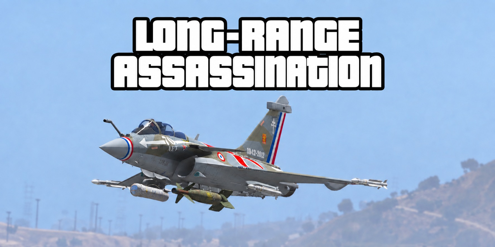

# Long-Range Assassination



GitHub / Source code: [Assassination](https://github.com/dun4law/GTAV-LongRangeAssassination)

## English

**Billionaire money. U.S. military-style firepower. Why are you still doing Lester's dirty work with a rifle?**

**It's 2027 in your Los Santos military fantasy. Stop handling contracts like it's 1945.** Bring your air wing and your fleet, and give your next assassination a modern-warfare upgrade.

The mansion is yours, your hangar is full of fighters, and warships are waiting offshore. Put yourself in command of a U.S. military-style operation, with a billionaire's budget and Los Santos as your playground. Take the cockpit or helm your ship, leave the street chases and gunfights behind, and turn Lester's next contract into a modern-warfare-style mission.

Long-Range Assassination brings a new way to play **The Multi Target Assassination**: load the mission target from kilometres away, lock on, and fire from your aircraft or armed ship. No closing in just to make the target spawn. No getting out to chase them down.

Currently supports Lester's **The Multi Target Assassination**, not every assassination mission.

### Requirements and installation

1. GTA V Legacy PC, Story Mode.
2. Install [Script Hook V](https://www.dev-c.com/gtav/scripthookv/) compatible with your game version.
3. Install [ScriptHookVDotNet](https://github.com/scripthookvdotnet/scripthookvdotnet) compatible with **API 3.7.0**. This script uses `ProjectileRocket`; older frameworks may not load it.
4. **For long-range attacks, install and configure [Vehicle Weapons Range Increase](https://www.gta5-mods.com/scripts/vehicle-weapons-range-increase)** following its author's instructions. This script handles spawning and additional targeting, not missile range or lifetime. Without enough range, missiles may disappear before reaching the target even after a successful lock.
5. Copy `LongRangeTargeting.dll` and `LongRangeTargeting.ini` from `dist` into your game's `scripts` folder.
6. Start/restart Story Mode.

### Start your long-range assassination

1. Start The Multi Target Assassination, finish the opening phone call and wait for the destination marker.
2. Enter the driver's seat of a plane or boat and select a missile weapon. Passenger and separate gunner seats are not supported.
3. Press **Ctrl+F10** to enable and allow the target area to load. A **yellow box** means the target is found but not locked: missiles still follow the vanilla target, or usually fly forward if none is locked.
4. Press **Ctrl+L**. Once you see a **red box + `LOCKED`**, fire normally. Newly fired, compatible missiles will follow the mission character instead of the vanilla HUD target; the vanilla lock indicator and sound remain unchanged.
5. Once the next target is ready, press **Ctrl+L** to lock it. Press again to unlock and restore normal behaviour for new shots; missiles already fired are not retargeted.
6. Press **Ctrl+F10** again to disable, or **Ctrl+F8** to toggle remote streaming. If you changed the INI hotkeys, use your custom bindings.

`No target` means no mission target has been identified; `Out of range` means the target exceeds your lock range. Edit `LockRangeMetres` under `[General]` in `scripts/LongRangeTargeting.ini` (for example, `LockRangeMetres=8000` for 8,000 metres; supported range: 500–10,000 metres, including altitude difference). Save, then toggle the script off and on. Increase `RangeMetres` too if the target must spawn farther away; increasing lock range does not increase missile range.

### Weapons and launch path

**Install and configure Vehicle Weapons Range Increase first, then choose a suitable long-range weapon.** This script handles targeting, not extra weapon range or obstacle avoidance.

- **Suggested weapon type:** use a long-range cruise missile or stand-off guided bomb with enough propulsion and lifetime for the distance.
- The following add-ons are optional examples, not the only supported choices: [Panavia Tornado IDS](https://www.gta5-mods.com/vehicles/panavia-tornado-ids-add-on-vehfuncs-v) with Storm Shadow/Taurus-style loadouts
- or the **AGM-86 cruise missile** loadout on the[B-52H Stratofortress](https://www.gta5-mods.com/vehicles/b-52h-stratofortress-add-on-vehfuncs-v). 
- The [F-35B Lightning II](https://www.gta5-mods.com/vehicles/f-35b-lightning-ii-add-on) with its **Spear 3** missile loadout, by [SkylineGTRFreak](https://www.gta5-mods.com/users/SkylineGTRFreak).
- **Avoid dropping ordinary bombs from too far away:** Paveway-style bombs — and even JDAM-style guided bombs — may hit the ground or run out of flight energy before reaching the target at extreme distances. Guidance does not guarantee enough range.
- **Watch your altitude and launch angle:** fly high enough and keep buildings and terrain out of the weapon's path, or it may hit the ground or a building early.

Weapons must use compatible standard rocket entities; ordinary bomb objects are not controlled. **`LOCKED` means target lock, not guaranteed arrival or impact.**

#### Target two: try anti-ship missiles

The second target is on a yacht off **Pacific Bluffs, near the Pipeline Inn**. Try anti-ship missiles to turn this hit into a naval strike — for example, the **ASM-2** loadout on the [Mitsubishi F-2A Viper Zero](https://www.gta5-mods.com/vehicles/mitsubishi-f-2a-viper-zero-add-on), by [SkylineGTRFreak](https://www.gta5-mods.com/users/SkylineGTRFreak).

#### Target four: skip the motorcycle chase

The fourth target rides a **Bati 801 in Vinewood Hills**. Forget chasing him through the streets with a gun: lock on from the air at long range while he's still waiting.

#### Naval strikes without taking off

Want a *Top Gun: Maverick* feel? [US Navy Fleet Surface Vessels](https://www.gta5-mods.com/vehicles/us-navy-fleet-surface-vessels-add-on), by [SkylineGTRFreak](https://www.gta5-mods.com/users/SkylineGTRFreak), invites you to trade your hangar for a fleet and launch **Tomahawks** from the sea without even taking a jet up.

### Custom settings

Edit `scripts/LongRangeTargeting.ini`. **Hotkeys and display settings reload about one second after saving**; `[General]` settings require toggling the script off and on.

#### Yellow or red bottom messages

Edit this line in the existing `[Display]` section:

```ini
BottomTextColor=Yellow
```

For red:

```ini
BottomTextColor=Red
```

For a custom colour, select `Custom`. RGB and alpha values range from 0–255:

```ini
BottomTextColor=Custom
BottomTextRed=255
BottomTextGreen=160
BottomTextBlue=40
BottomTextAlpha=235
```

`Yellow` uses RGB `255,220,80`; `Red` uses `255,60,60`. Yellow is the default and the fallback for unrecognised colour names.

#### Hotkeys

```ini
[Hotkeys]
Toggle=Ctrl+F10
Lock=Ctrl+L
Streaming=Ctrl+F8
```

Use Windows Forms `Keys` names and combinations such as `F6`, `L`, `Alt+L` or `Ctrl+Shift+K`.
Use different combinations for each action. Invalid bindings fall back to defaults; duplicate bindings retain the previous valid set.

#### Hide text and adjust message duration

```ini
[Display]
ShowStatusText=false
ShowDistance=false
ShowTargetBox=true
ShowBottomMessages=true
MessageDurationMs=1800
```

- `ShowStatusText`: persistent status text; disabled by default.
- `ShowDistance`: distance beside the status text; requires `ShowStatusText=true`.
- `ShowTargetBox`: yellow/red target box.
- `ShowBottomMessages`: short bottom messages, including errors; full errors are still logged.
- `MessageDurationMs`: display duration; 1800 means 1.8 seconds, with a range of 300–10000.
- `TextRed`, `TextGreen`, `TextBlue`, `TextAlpha`: persistent status-text colour, separate from bottom messages.

#### Mission and streaming settings

`PlayerPriorityStreaming=true` (default) restores normal player-area streaming once the target is found, or after an 8-second remote-loading budget per stage. If loading pauses, toggle the tool off/on to retry. This reduces prolonged remote-focus usage, but does not guarantee high-detail scenery or collision at both locations. Remote target persistence and missile impacts still need in-game testing. Set it to `false` to restore continuous remote focus. Save and toggle off/on to apply. Logs report `Player streaming restored` with `target_ready` or `8s_budget`.

For automatic red-box locking without pressing Ctrl+L, set `AutoLock=true` below. It defaults to `false`. Save and toggle the tool off/on. Valid targets within `LockRangeMetres` are locked automatically, including the next mission target; missing or out-of-range targets still require waiting. In auto mode, Ctrl+L only shows a reminder; disable AutoLock to return to manual locking. This does not add obstacle avoidance.

```ini
[General]
AutoLock=false
RangeMetres=5000
LockRangeMetres=5000
RemoteStreaming=true
PreventDistanceEscape=true
```

- `RangeMetres`: mission-target spawn threshold, 500–10000 metres, including altitude difference. This does not guarantee correct collision simulation or impacts at that distance.
- `LockRangeMetres`: independent acquisition/retention range, 500–10000 metres, including altitude difference. Exceeding it drops the lock; missiles already fired are not retargeted.
- Set both to `8000` for 8 km spawning and locking. Increasing lock range alone does not spawn missing targets or extend missile lifetime.
- `RemoteStreaming`: moves the streaming focus towards the target; toggle it with the Streaming hotkey.
- `PreventDistanceEscape`: suppresses this mission's distance/visibility escape helper while enabled. Other failure conditions remain.

### Damage and death logs

Check `scripts/LongRangeTargeting.log`: `Target damaged` records observed health loss; `Target death confirmed` records death, the game's cause-weapon hash and source entity. `Assigned rocket ended` records a tracked missile disappearing, its elapsed time and last observed distance to its target (`-1` means unavailable). Disappearance is not proof of impact, and damage/death is not proof that a particular missile caused it. Tracking ends when the tool is disabled; events between frames or after an entity is removed may not be observable.

### Source code

Source code is available on [GitHub](https://github.com/dun4law/GTAV-LongRangeAssassination).

### Uninstall

Exit GTA V and remove `scripts/LongRangeTargeting.dll` and its INI. Keep the log if you wish.

### Credits and technical references

Special thanks to [SkylineGTRFreak](https://www.gta5-mods.com/users/SkylineGTRFreak) for years of GTA V addon vehicles. From fighter jets to naval ships, that variety lets us reimagine ordinary assassination missions as modern air and naval strikes, and helped bring Long-Range Assassination's gameplay to life. Thank you for your time, creativity and continued dedication!

The featured addon vehicles belong to their respective creators. Download them from their original pages and support the authors; they are not included with this script.

- [ScriptHookVDotNet](https://github.com/scripthookvdotnet/scripthookvdotnet): rocket-targeting APIs, runtime script-table structures and discovery.
- [Cfx.re Native documentation](https://github.com/citizenfx/natives): native function references.
- [Mission analysis reference](https://github.com/calamity-inc/GTA-V-Decompiled-Scripts): mission flow and spawn thresholds.

## 繁體中文

### Long-Range Assassination｜遠距離暗殺

**富豪級財力，美軍式火力。替萊斯特辦事，你還在只靠一把步槍？**

**在你的洛聖都軍事幻想裡，都 2027 年了，別再用 1945 年的方式辦事。** 帶上你的飛行中隊與艦隊，讓下一場暗殺升級成現代戰爭式行動。

豪宅是你的，機庫裡停滿戰機，外海還有軍艦待命。現在，把自己當成美軍式行動的指揮官，帶著億萬富豪的預算，把洛聖都變成你的遊樂場。坐進戰機，或親自駕駛軍艦，告別街頭追逐與槍戰，讓萊斯特的下一份合約升級成現代戰爭風格的任務。

Long-Range Assassination 為「多重暗殺行動」帶來全新的玩法：從數公里外載入任務目標，鎖定，再從戰機或武裝船艦發射。不必靠到目標面前等人物出現，也不必離開載具追人。

目前支援萊斯特的 **The Multi Target Assassination（多重暗殺行動）**，不是所有暗殺任務通用。

## 必備模組與安裝

1. GTA V Legacy PC 故事模式。
2. 安裝與遊戲版本相容的 [Script Hook V](https://www.dev-c.com/gtav/scripthookv/)。
3. 安裝 [ScriptHookVDotNet](https://github.com/scripthookvdotnet/scripthookvdotnet) **3.7.0 API** 相容版本。本工具使用 `ProjectileRocket` API；舊版框架可能無法載入。
4. **遠距離玩法必備：安裝並依作者說明設定 [Vehicle Weapons Range Increase](https://www.gta5-mods.com/scripts/vehicle-weapons-range-increase)。** 本工具只處理任務生成與額外鎖定，不會延長導彈射程／壽命。若武器沒有足夠射程，即使成功鎖定，導彈仍可能在抵達前消失，無法完成遠距離攻擊。
5. 將本儲存庫 `dist` 資料夾內的 `LongRangeTargeting.dll` 和 `LongRangeTargeting.ini` 放入遊戲的 `scripts` 資料夾。
6. 啟動／重新啟動故事模式。


## 開始你的遠距離暗殺

1. 開始多重暗殺行動，完成開場電話，等候任務目的地出現。
2. 坐進飛機或船隻駕駛席，選擇導彈武器（不支援乘客／獨立炮手席）。
3. 按 **Ctrl+F10** 啟用，等待目標區域載入。**黃框**表示找到目標但尚未鎖定：導彈仍追蹤原版鎖定目標，沒有鎖定時通常向前直飛。
4. 按 **Ctrl+L**，出現**紅框＋`LOCKED`**後照常發射。新發射的相容導彈會改為追蹤任務人物，而不是原版 HUD 的目標；原版鎖定框與聲音不會同步改變。
5. 下一個目標準備完成後，再按 **Ctrl+L** 鎖定。再次按下可解除，新發射武器恢復原本行為；已發射的導彈不會重新指定目標。
6. 再按 **Ctrl+F10** 關閉工具；**Ctrl+F8** 可切換遠處載入。若已修改 INI 快捷鍵，請使用自訂按鍵。

`No target` 表示目前尚未辨識到任務目標；`Out of range` 表示目標超過設定的鎖定距離。可在遊戲 `scripts/LongRangeTargeting.ini` 的 `[General]` 區段修改 `LockRangeMetres`（例如 `LockRangeMetres=8000`，即 8000 米；支援 500–10000 米，包含高度差）。儲存後，關閉再啟用工具即可生效。若也需要在更遠處生成目標，請同時調整 `RangeMetres`；增加鎖定距離本身不會增加導彈射程。

## 武器選擇與發射路線

**先安裝並設定 Vehicle Weapons Range Increase，再選擇適合遠距離攻擊的武器。** 本工具負責鎖定，不會增加武器射程，也不會讓導彈自動避開障礙物。

- **建議武器類型：** 使用具備足夠推力與續航的巡弋導彈或遠距離導引炸彈。
以下附加模組只是示例，不是唯一選擇
[Panavia Tornado IDS](https://www.gta5-mods.com/vehicles/panavia-tornado-ids-add-on-vehfuncs-v) 的 Storm Shadow／Taurus 類掛載，或 [B-52H Stratofortress](https://www.gta5-mods.com/vehicles/b-52h-stratofortress-add-on-vehfuncs-v) 的 **AGM-86 巡弋導彈**。 [F-35B Lightning II](https://www.gta5-mods.com/vehicles/f-35b-lightning-ii-add-on) 的 **Spear 3** 導彈掛載。作者都是 [SkylineGTRFreak](https://www.gta5-mods.com/users/SkylineGTRFreak)

- **避免從太遠處投放普通炸彈：** Paveway 等炸彈，甚至 JDAM 類導引炸彈，在極遠距離也可能因飛行能量或射程不足而提前落地。有導引不代表有足夠射程。
- **注意高度與發射角度：** 飛得夠高，並確保武器前往目標的路線沒有建築物或地形阻擋，否則仍可能提前撞地或撞樓。

武器必須使用本工具可接管的標準火箭實體；普通炸彈物件不會被接管。**顯示 `LOCKED` 代表鎖定成功，不代表武器一定能抵達或命中。**

### 第二個目標：試試反艦導彈

第二個目標在 **Pacific Bluffs 外海、Pipeline Inn 附近的遊艇上**，建議試試反艦導彈，把這次暗殺玩成海上打擊。例如 [Mitsubishi F-2A Viper Zero](https://www.gta5-mods.com/vehicles/mitsubishi-f-2a-viper-zero-add-on) 的 **ASM-2** 掛載（作者：[SkylineGTRFreak](https://www.gta5-mods.com/users/SkylineGTRFreak)）。

### 第四個目標：省掉機車追逐

第四個目標是 **Vinewood Hills 騎著 Bati 801 的騎士**。不用拿槍追過幾條街：趁他還在原地，從空中遠距離鎖定。

### 不用起飛的海上打擊

想要更有《Top Gun: Maverick》電影感？[US Navy Fleet Surface Vessels](https://www.gta5-mods.com/vehicles/us-navy-fleet-surface-vessels-add-on)（作者：[SkylineGTRFreak](https://www.gta5-mods.com/users/SkylineGTRFreak)）讓人很想把機庫換成艦隊，從海上發射 **Tomahawk**，連戰機都不用開。

## 自訂設定

編輯遊戲 `scripts/LongRangeTargeting.ini`。**快捷鍵及顯示設定儲存後約一秒自動生效**，不必重新啟動；`[General]` 需要關閉再啟用工具。

### 底部文字改成黃色或紅色

在現有 `[Display]` 區段修改這一行：

```ini
BottomTextColor=Yellow
```

改成紅色：

```ini
BottomTextColor=Red
```

自訂顏色時使用 `Custom`，RGB 及不透明度範圍均為 0–255：

```ini
BottomTextColor=Custom
BottomTextRed=255
BottomTextGreen=160
BottomTextBlue=40
BottomTextAlpha=235
```

`Yellow` 使用 RGB `255,220,80`；`Red` 使用 `255,60,60`。預設為黃色。無法辨識的顏色名稱會使用黃色。

### 快捷鍵

```ini
[Hotkeys]
Toggle=Ctrl+F10
Lock=Ctrl+L
Streaming=Ctrl+F8
```

可填 `F6`、`L`、`Alt+L`、`Ctrl+Shift+K` 等 Windows Forms `Keys` 鍵名組合。
三個操作請使用不同組合；無效按鍵會退回該操作預設值，重複組合則保留上一組有效設定。

### 隱藏文字與提示時間

```ini
[Display]
ShowStatusText=false
ShowDistance=false
ShowTargetBox=true
ShowBottomMessages=true
MessageDurationMs=1800
```

- `ShowStatusText`：常駐狀態文字；預設關閉。
- `ShowDistance`：在狀態文字旁顯示距離，只有 `ShowStatusText=true` 才有效。
- `ShowTargetBox`：黃／紅目標框。
- `ShowBottomMessages`：底部短提示，包括錯誤提示；完整錯誤仍寫入記錄。
- `MessageDurationMs`：提示時間，1800 代表 1.8 秒，有效範圍 300–10000。
- `TextRed`、`TextGreen`、`TextBlue`、`TextAlpha`：常駐狀態文字的顏色，與底部顏色分開設定。

### 任務與載入設定

`PlayerPriorityStreaming=true`（預設）會在找到目標後恢復玩家附近的正常載入；每個任務階段的遠處載入最多持續 8 秒。若載入暫停，可關閉再啟用工具重試。這能減少長時間佔用遠處載入重心，但不保證兩地都維持高細節與完整碰撞；遠處人物保留及導彈命中仍需遊戲內測試。設為 `false` 可恢復持續遠處載入。儲存後關閉再啟用生效。記錄會顯示 `Player streaming restored`，原因為 `target_ready` 或 `8s_budget`。

想自動進入紅框鎖定、不必按 Ctrl+L，可將下方的 `AutoLock` 改為 `true`，預設為 `false`。儲存後關閉再啟用工具生效。有效目標進入 `LockRangeMetres` 範圍便會自動鎖定，下一個任務目標亦同；尚未生成或超出距離時仍需等待。自動模式下 Ctrl+L 只顯示提醒，關閉 AutoLock 才恢復手動鎖定。此設定不包含避障功能。

```ini
[General]
AutoLock=false
RangeMetres=5000
LockRangeMetres=5000
RemoteStreaming=true
PreventDistanceEscape=true
```

- `RangeMetres`：任務人物生成門檻，500–10000 米，包含高度差。設定值不代表引擎一定能在該距離正確模擬碰撞及命中。
- `LockRangeMetres`：獨立的鎖定／維持鎖定距離，500–10000 米，包含高度差。超出時解除鎖定，已發射的導彈不重新指定。
- 例如想在 8 公里外生成並鎖定，兩項都填 `8000`；只增加鎖定距離不會生成尚未出現的人物，也不會增加導彈壽命。
- `RemoteStreaming`：把載入重心移往目標區域；可用 Streaming 快捷鍵切換。
- `PreventDistanceEscape`：啟用期間抑制本任務的距離／可見性逃脫輔助判定。其他失敗條件仍保留。

## 傷害與死亡記錄

查看 `scripts/LongRangeTargeting.log`：`Target damaged` 記錄觀察到的生命值下降；`Target death confirmed` 記錄已確認死亡、遊戲回報的致死武器代碼與來源實體；`Assigned rocket ended` 記錄導彈消失、經過時間及最後觀察到的目標距離（`-1` 表示無資料）。消失不等於命中，傷害／死亡也不代表由某一枚導彈造成。關閉工具便停止追蹤；兩幀之間或人物被移除後的事件可能無法觀察。

## 原始碼

原始碼公開於 [GitHub](https://github.com/dun4law/GTAV-LongRangeAssassination)。

## 移除

退出 GTA V，移走 `scripts/LongRangeTargeting.dll` 及其 INI 即可。記錄檔可自行保留。

## 致謝與技術參考

特別感謝 [SkylineGTRFreak](https://www.gta5-mods.com/users/SkylineGTRFreak) 多年來持續為 GTA V 製作各式附加載具，從戰機到軍艦，帶來如此豐富的選擇。正是這些作品，讓我們能把普通的暗殺任務玩出現代空戰與海上打擊的想像，也讓 Long-Range Assassination 的玩法得以成形。感謝你的時間、創意與長年投入！

本文介紹的附加載具由各自作者製作，請到原始發布頁下載並支持作者；本工具不包含這些載具。

- [ScriptHookVDotNet](https://github.com/scripthookvdotnet/scripthookvdotnet)：火箭追蹤 API、執行期腳本表結構與定位方式。
- [Cfx.re Native 文件](https://github.com/citizenfx/natives)：遊戲原生函式說明。
- [公開任務分析資料](https://github.com/calamity-inc/GTA-V-Decompiled-Scripts)：任務流程及生成門檻核對。

## Optional air-war scenario / 可選空戰情境

### Mission scenario

- To turn the mission into a modern air-war scenario, pair it with [AirForce Intercept When Wanted w/ SixStar Support](https://www.gta5-mods.com/scripts/airforce-intercept-when-wanted-w-sixstar-support).

You are entering hostile airspace for a quiet assassination. Keep your presence hidden: deploy a fifth-generation fighter, stay outside the target's immediate area, and strike from long range before the enemy knows you are there.

If your presence is detected and an intercept is triggered, enemy fighters may scramble after you. Complete the assassination before the mission clock runs out, shoot down or evade the interceptors, and get home without being shot down. This is an optional companion mod, not a requirement.

### 任務情境

- 想把任務玩成現代空戰，可搭配 [AirForce Intercept When Wanted w/ SixStar Support](https://www.gta5-mods.com/scripts/airforce-intercept-when-wanted-w-sixstar-support)。

你正在進入敵方領空，執行一場必須保持低調的暗殺。派出第五代戰機，留在目標近距離之外，從遠處發動攻擊，在敵人察覺前完成任務。

一旦行蹤暴露並觸發攔截，敵方戰機可能升空追擊。你要在任務時限內完成暗殺，擊落或甩掉攔截機，並避免被擊落返航。這是可選的搭配模組，不是本工具的必要元件。
